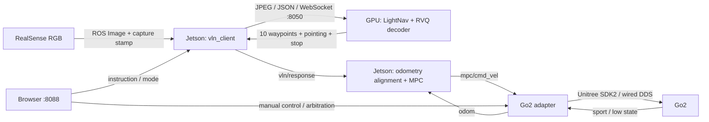

# LightNav real-world deployment

完整的 LightNav 双机部署仓库：GPU 上位机运行原版模型推理，Jetson 下位机负责相机、ROS 2、MPC、Go2 控制和实验录制。这里整合官方源码、实际部署快照中的改动、此前未提交的录制模块和两端配置。



## 两端职责

| 位置 | 环境 | 工作 |
| --- | --- | --- |
| GPU 上位机 | Python 3.11、CUDA、vLLM 0.19.1 | 模型、历史帧、RVQ 解码、WebSocket、推理响应与性能记录 |
| Jetson 下位机 | Ubuntu 22.04、ROS 2 Humble、Python 3.10 | 相机客户端、里程计对齐、CasADi MPC、SDK2、网页、MCAP 与视频 |
| 浏览器 | 能访问 Jetson 的设备 | 指令、任务模式、手动/自动控制、状态、录制查看 |

Jetson 不需要安装根目录的 LightNav Python 包、Torch 或模型权重。上位机不需要 ROS。机器人启动文件订阅现有相机流，默认不重复启动 RealSense 驱动。

## 快速部署

两端分别克隆相同仓库：

```bash
git clone git@github.com:AlanZhu2006/lightnav_realworld.git
cd lightnav_realworld
```

**上位机：**

```bash
bash deployment/server/setup.sh
cp -n config/server.env.example config/server.env
.venv-server/bin/hf download LightOriginsHQ/LightNav-0 \
  --revision 826dc5fbfa37afa8293d2e336d329b6ffc0bfb64 \
  --local-dir checkpoints/LightNav-0
bash deployment/server/start.sh --check
bash deployment/server/start.sh
```

模型预热和端口监听完成后才创建 `runtime/server.json` 中的 `ready_file`。详细安装、配置和 systemd 使用见 [上位机部署](docs/REALWORLD_SERVER.md)。

**Jetson：**先安装 ROS 2 Humble 与录制依赖；完整命令、SDK2 和相机安装见 [下位机部署](docs/REALWORLD_ROBOT.md)。

```bash
bash deployment/robot/setup.sh
# 编辑 config/robot.env：设置 ws://GPU_HOST:8050、Go2 有线网卡、CycloneDDS 路径。
# 按下位机文档安装 SDK2 / CycloneDDS，配置已安装的 RealSense overlay。
source robot-env.sh
bash robot_deploy/scripts/build.sh
source robot-env.sh
bash deployment/robot/start.sh --check
bash deployment/robot/start.sh
```

浏览器打开 `http://JETSON_HOST:8088`。启动时 MPC 和控制源均禁用；操作员通过页面选择模式和控制。默认速度上限 `0.3 m/s`、`0.5 rad/s`。

## 文档与验证

- [双机数据流与坐标/时间戳](docs/REALWORLD_DATAFLOW.md)
- [录制、归档与同步](docs/REALWORLD_RECORDING.md)
- [配置变量与启动参数](docs/REALWORLD_CONFIGURATION.md)
- [验证范围与复测方法](docs/REALWORLD_VALIDATION.md)
- [源码来源与快照恢复](docs/REALWORLD_PROVENANCE.md)
- [WebSocket 协议](docs/PROTOCOL.md)、[官方推理配置](docs/CONFIGURATION.md)
- [官方原始 README](UPSTREAM_README.md)、[MuJoCo demo](mujoco_demo/README.md)

仅打印两端命令：

```bash
bash deployment/server/start.sh --dry-run
LIGHTNAV_SERVER_URL=ws://GPU_HOST:8050 bash deployment/robot/start.sh --dry-run
```

CPU 测试覆盖推理、客户端/服务端真实 socket 协议、MPC、SDK 接口替身和录制流程：

```bash
make check
make test PYTHON=.venv-server/bin/python
```

服务启动后，使用实际机器人客户端发送本地图片；不启动 ROS 或机器人：

```bash
.venv-server/bin/python -m deployment.smoke_protocol \
  --server ws://127.0.0.1:8050 --image /path/to/frame.jpg \
  --instruction 'approach the plant' --output runtime/protocol-smoke.json
```

权重、机器私有配置、原始实机数据和日志不进入 Git。两端 `config/*.env` 与录制目录已忽略；模板、源码、依赖、文档和测试均包含在仓库中。

## 来源

基于 [lightorigins/LightNav-0](https://github.com/lightorigins/LightNav-0) 的 `3015508`，保留 Git 历史与 Apache-2.0 许可证。实机改动来自已有 Go2/RealSense 部署快照，输入校验记录见 [source-manifest.json](deployment/source-manifest.json)。本次是部署整合，不包含新的世界模型或训练方法。
