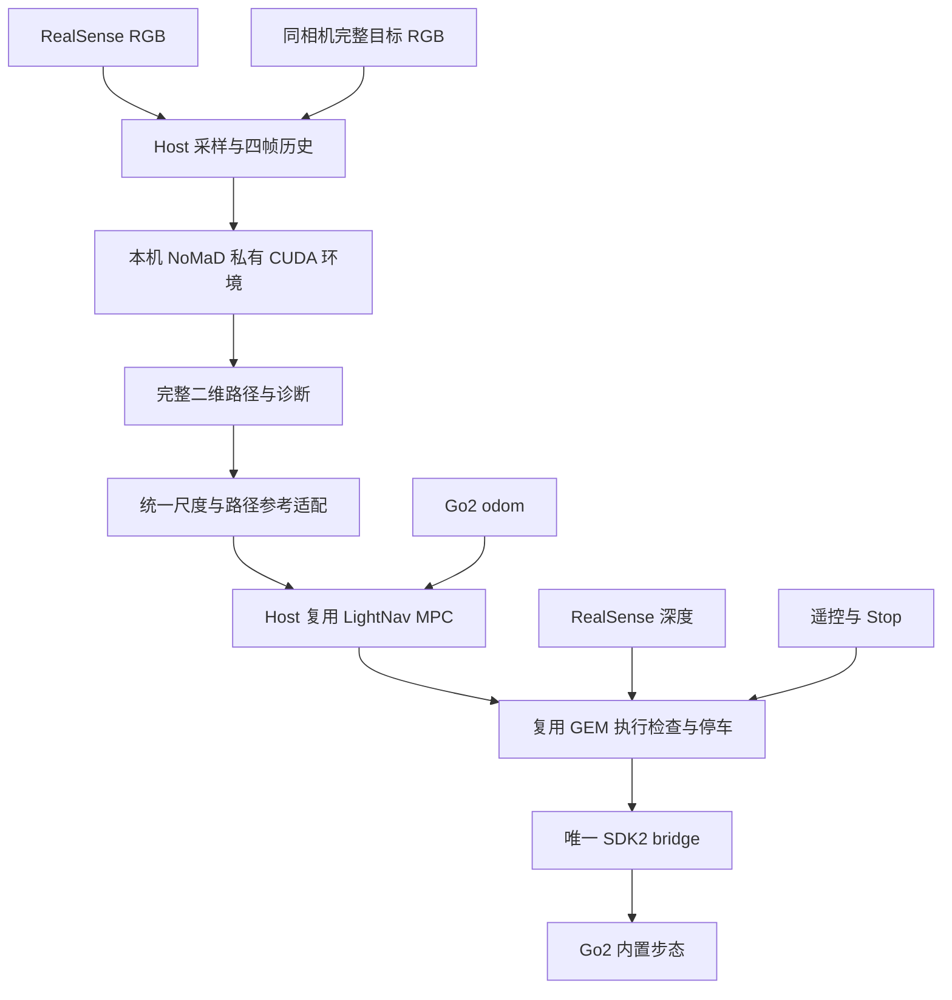

> Sanitized historical source snapshot. Dates, old hardware observations and results refer to the original deployment; paths below are portable examples, not a claim that this checkout is deployed. Current entry: [REALWORLD_GO2_CONSOLE.md](REALWORLD_GO2_CONSOLE.md).

# tandon go2 上的 NoMaD 部署方案

2026 年 10 月 17 日。当前先在 `go2` 独立跑通 NoMaD，再接入 DejaView。下位机项目根目录固定为 **`/home/unitree/work/lightnav_realworld`**。主部署目标是 Orin NX 本地推理与本地控制，工作站用于数值参考和必要时的临时推理；NavDP 保留为后续后端，LightNav 保持独立 baseline。

执行与操作基础优先复用用户已经在 Go2 跑通的仓库：**LightNav 的 MPC、GEM 的 cmd_vel bridge/执行检查/Foxglove、TinyNav 的 VNC 工作流**。NoMaD 提供完整局部路径，只新增必要的轨迹与任务接口适配。官方 PD 保留为数值和故障诊断参考，不作为必须先完成的另一套真机主线。

当前已完成锁定源码和权重部署、官方 RealSense RGB-D、Jetson 本机 CUDA 完整推理、真实 ImageGoal 任务/网页/ROS/Foxglove、原 MPC 动态反馈演练与 SDK 私有依赖。没有初始化 Unitree 运动客户端或发送运动命令；Go2 实际反馈、前向安装/时基验收和实体导航仍待完成。实际记录见 完整部署验收 (original workspace document; not part of this LightNav import)，可执行命令见 [部署入口](../deployment/nomad/README.md)。

## 一 机器状态与当前缺项

| 项目 | 本轮实测 | 部署含义 |
| --- | --- | --- |
| SSH | alias `go2`，用户 `unitree` | 地址沿用 SSH 配置 |
| 板卡 | Jetson Orin NX，约 16 GB RAM | 本地 NoMaD 实推已通过，持久 worker warm RTT 中位数约 354 ms |
| 系统 | Ubuntu 22.04.5，aarch64，Python 3.10.12 | host 适合 ROS 2 Humble |
| BSP | L4T 36.5.0，kernel 5.15.185-tegra | 对应 JetPack 6.2.2 系列 BSP |
| GPU | CUDA 12.6 toolkit、cuDNN 9.3、TensorRT 10.3 实际已存在；Orin CUDA/NMS/完整 NoMaD 均通过 | nvcc 原先仅未进 PATH；不据旧 PATH 检查推断缺软件 |
| 功耗 | 15 W，4 核 online | 先测现状，不先改 MAXN |
| 存储 | 根盘约 233 GB，可用约 213 GB | 可保存推理环境和短程录制 |
| 软件 | Humble、OpenCV、cv_bridge、MCAP 可用；CPU/GPU Torch 2.8 分开；RealSense 2.58.4 / ROS 4.58.4、Foxglove 3.6 为用户目录 overlay；SDK2/Cyclone Python 独立环境 | 无需 Docker 即已本机 CUDA 实推；真实 Go2 反馈待接入 |
| 相机 | D435i / USB 2.1，官方 ROS RGB+aligned depth 640×480@15 连续 100 对通过，SDK global-time 映射到 ROS header | 前向安装尚未验收；内部 RGB-D 对齐已验证，实装外参与 Go2 时间对齐待验 |
| 有线网 | `enP8p1s0`，`192.168.123.18/24`，1000 Mb/s full duplex，carrier=1 | 物理链路正常 |
| Go2 参考地址 | 本轮再次向 `192.168.123.161` 发出两个 ping 均无响应，ARP 未解析 | 实际地址和 SDK 状态仍待确认 |

本轮后续检查确认相机已经接入，早期未枚举的状态已被新实测替代。早期天花板记录与最新侧转室内画面只用于 IO 检查，不能验证前向导航。Go2 参考地址再次检查仍未通，不能据此确定机器未开机或真实地址；SDK 只读阶段继续核实，先保持现有网络配置。

工作站实测为 RTX 5090。其 `memnav` 环境已有可用 CUDA、Torch 2.8.0+cu128、torchvision 0.23.0+cu128、Diffusers 0.33.1，另建 `.venv-nomad-server` 继承该环境并安装 EfficientNet 与 CasADi，未修改原环境；`habitat` 环境本轮未发现 Torch。旧记录中的环境状态不作为当前安装依据。

JetPack 与 BSP 关系见 [NVIDIA JetPack 6.2.2](https://developer.nvidia.com/embedded/jetpack-sdk-622)。

## 二 本机闭环



host 持有相机、四帧历史、当前目标、任务版本、MPC 和执行状态。独立模型进程只接收四张真实 RGB 与一张目标 RGB，输出预测与诊断，不访问相机或机器人。这样没有第二份隐式观测 FIFO，也不把 Wi-Fi 往返放入首版运动闭环。当前使用已实测的 host 私有 CUDA venv，下面的容器方案仅为备选。

深度只用于独立停车与录制，不输入 NoMaD。Go2 odom 用于采图姿态锚定和 MPC 反馈，不进入 DejaView 记忆。首轮不加入 DejaView、单目深度模型、VLA、MID360 或全局 SLAM。后续 DejaView 只替换目标图的来源，保留已经验证的局部策略与执行出口。

## 三 成熟仓库的具体复用

本轮重新核对三个 GitHub HEAD，均与此前审查的锁定版本一致。用户已确认这些系统在 Go2 成功运行；新机器仍需验证路径、依赖、接口和组合后的行为。

| 来源和模块 | 首版用途 | 必要适配 |
| --- | --- | --- |
| LightNav `vln_mpc/mpc.py` | CasADi/IPOPT 单轮车 MPC，10 Hz、horizon=5、dt=0.1 s | 保留优化器，配置适合 NoMaD 的速度/加速度和参考点 |
| LightNav `vln_mpc/geometry.py` 与 `mpc_node.py` | 采图时刻 odom 插值、坐标转换、异步求解、结果版本与路径可视化 | 输入改为 NoMaD 路径，补源图/路径时效，不移植语言任务协议 |
| GEM `deployment/go2/go2_cmd_bridge.py` | SDK2、物理遥控优先、命令 watchdog、Stop 与状态输出 | 按本机网口与固件配置，显式 disabled 启动，保留唯一 writer |
| GEM `latency_motion_guard.py`、`trajectory_control.py` | 源图时效与深度停车相关逻辑 | 只迁移 guard，不把原 pure-pursuit tracker 串在 MPC 后 |
| GEM Foxglove scripts、image relay、layout | 无桌面实时观测与录制 | 替换 topic/服务/状态绑定，不拉起 NavDP/CEC 专属生命周期 |
| TinyNav `scripts/run_visible_vnc.sh` | TigerVNC 独立桌面与 RViz 调试 | 旧用户名、路径和认证改成本机配置 |
| LightNav `robot_deploy/src/vln_web` | 可选的网页控制、轨迹叠加、参数与录制面板 | 保留为后续操作界面选择；不先启动整套 VLN client/web |

LightNav 的 [MPC](https://github.com/AlanZhu2006/lightnav_realworld/blob/ddfd37059c49e8090217e11c4ffa6f6b3ff9d554/robot_deploy/src/vln_mpc/vln_mpc/mpc.py) 与模型服务独立，适合复用。GEM 当前实机 tracker 是轻量路径跟踪，不能因为其 baseline 目录存在 MPC 就称其主执行链为 MPC。TinyNav 的主要价值是实际相机、cmd_vel、远程桌面和运行经验。

运动出口默认采用 [GEM bridge](https://github.com/AlanZhu2006/GEM-RealWorld/blob/fd23b5d4006226e7a76b2c3f0bf03a8ec16e3436/deployment/go2/go2_cmd_bridge.py) 的 SportClient 路径。LightNav adapter 使用另一套控制仲裁及 ObstaclesAvoidClient，不与 GEM bridge 同时启动；若现场采用该已验证路径，作为另一个明确 profile 切换。

## 四 软件环境

### 本机模型已通过原生私有 GPU 环境

实际采用 `.venv-nomad-gpu`，锁定 Jetson AI Lab cu126 Torch 2.8 / torchvision 0.23 wheel 并校验 SHA256，使用 host 已有 CUDA/cuDNN；未修改系统包或 CPU venv。真实 CUDA、vision NMS 与 17 个 RGB-D 窗口完整推理均通过。持久推理 worker 的本机 HTTP RTT 中位数 354 ms，输入采样保持 4 Hz，模型输出尚非 4 Hz。实际安装/相机/性能细节见 [GPU 与 RGB-D 验收](DEJAVIEW_JETSON_GPU_RGBD_20261017.md)。

下列 iGPU 容器方案保留为备选，不再作为当前已跑通路径的前置：

保留当前 BSP。首选验证候选为 `nvcr.io/nvidia/pytorch:25.06-py3-igpu`。官方 Jetson 兼容表将该版本对应到 JetPack 6.2 系列；NGC 元数据明确为 ARM64/L4T、Python 3.12。这是官方支持系列内的候选，尚未在本机 36.5.0 实测通过。

依据：[Jetson PyTorch 兼容表](https://docs.nvidia.com/deeplearning/frameworks/install-pytorch-jetson-platform-release-notes/pytorch-jetson-rel.html)、[确切 iGPU 镜像](https://catalog.ngc.nvidia.com/orgs/nvidia/-/containers/pytorch/25.06-py3-igpu/layers)。不根据普通桌面 GPU 镜像的 CUDA/驱动条件推断 iGPU 镜像已经兼容。

host 准备 Docker 与 NVIDIA Container Toolkit/runtime，依次验证容器启动、CUDA tensor、卷积、实际 NoMaD diffusion。容器携带推理库，host 不先安装整套 CUDA developer toolkit 或另外一套 Torch；若发现明确的 host runtime 缺项，再按依赖补齐。[NVIDIA Container Toolkit](https://docs.nvidia.com/datacenter/cloud-native/container-toolkit/latest/install-guide.html)

派生镜像保留 NVIDIA 的 Torch/torchvision，只增加锁定的 NoMaD、Diffusion Policy、EfficientNet 和服务依赖，不用普通 `pip install torch torchvision` 覆盖。固定实际 image digest 与最终依赖清单。镜像内只开放本机推理接口，不挂载相机或运动设备。

上游旧环境为 Python 3.8、CUDA 11、Diffusers 0.11.1，不原样照搬。现有 Diffusers 0.33.1 可作为数值参考起点，但 Python 3.12、旧库导入和实际采样行为仍需验证；保留 scheduler 参数与模型结构，不先做 TensorRT、量化或训练。

### 机器人环境留在 host

Ubuntu 22.04/Python 3.10 运行 ROS 2 Humble、RealSense、CasADi/MPC、robot runtime 与 SDK2。任务 venv 使用 `--system-site-packages` 访问 ROS；模型使用另一个 `.venv-nomad-gpu`。若以后采用备选容器，容器 Python 不导入 host Humble/cv_bridge，不把容器 Torch 拷到 host。

NoMaD 的 ROS 1 transport 不迁移，不加 ROS 1 bridge。机器人侧复用 GEM 的 ROS 2 与 SDK 出口。SDK2/CycloneDDS 的实际版本、DDS interface、运动 topic 和状态 topic 分别记录。

若本机 CUDA 容器受阻或实际吞吐不足，先在工作站建立同一模型数值参考，必要时暂时 offboard；接口和源帧检查保持相同。不会为解决 Torch 依赖重刷或升级 JetPack 大版本。

## 五 相机与时间契约

已核实 D435i、serial/FW/USB 2.1，并采用唯一官方 ROS 相机发布者，640×480@15 RGB-D、enable_sync 与 align_depth 均通过。100 对图像及 SDK metadata/内参/时间映射已保存；不再与 V4L2 reader 同时占相机。首版只开前向 color 与用于本地停车的 aligned depth，不要求点云、红外或相机 IMU。

优先评估官方 native backend；若当前 kernel 的深度/metadata 支持不足，原型可选官方 RSUSB backend，避免先修改内核。RSUSB 有性能/功能取舍，仍需验证同步与帧稳定性。[RealSense Jetson 指南](https://github.com/realsenseai/librealsense/blob/master/doc/installation_jetson.md)

验收保存实际 RGB、深度和一段运动视频，检查源时间、颜色、曝光、掉帧、深度单位、对齐和有效区域。固定相机安装高度/俯仰，同一相机采集当前图与目标图；不从手机或其他视角随意替换目标。

锁定模型 `context_size=3`，实际需要历史三帧加当前一帧。host 维护源帧 ID/时间，等四个不同真实观察齐备才推理；重连或严重断流后重建，不复制当前帧伪造历史。

以 **4 Hz 显式观测采样**作为部署起点，四帧约覆盖 0.75 秒。4 Hz 来自锁定官方机器人配置的参考值，是本次明确的采样配置；官方 callback 本身接收每条相机消息，不能声称它强制同样时间间隔。直接取 30 Hz 的最后四帧只跨约 0.1 秒，两者不等价。实际间隔、模型吞吐和源图年龄必须分别记录。

观测采样、推理、MPC 和 SDK 循环分别计时；模型慢时不堆积旧请求。输入明确转 RGB，按原代码直接 PIL resize 96×96、无中心裁剪、ImageNet mean/std。当前与目标图使用同一颜色路径；原 `msg_to_pil()` 忽略 encoding/step，不直接处理任意相机消息。

## 六 模型数值与 MPC 轨迹适配

| 项目 | 首轮锁定值或行为 |
| --- | --- |
| 官方源码 | `dca79815b704e5aa9c6bdc3082351f9e3b2848c2` |
| Diffusion Policy | reference commit `5ba07ac6661db573af695b419a7947ecb704690f`，迁移前复核文件 |
| checkpoint | 已有 `nomad.pth`，76,473,631 bytes，本轮重新核对哈希 |
| checkpoint SHA256 | `70f79b8262527e20e56ced64a3e3d7ef91855bc9e7c3fa348d78edcb83c6a333` |
| 输入 | 四张 RGB、一张完整目标 RGB，goal mask=0 |
| 扩散 | 10 steps、8 个样本 |
| 输出 | 每个样本 8 个累计二维 waypoint，不再积分一次 |
| 选择 | 保留官方首个样本；完整路径供 MPC，index=2 供 PD 数值参考 |
| 原尺度参考 | 官方选中 waypoint 乘 `0.2 / 4 = 0.05`；路径适配统一采用显式系数并验证 |
| 权重加载 | 严格 state_dict，eval/inference mode，不训练 |

`baseline_eval/nomad_native.py` 用作数值参考；它绑定绝对权重路径、topomap cursor、`radius=2` 和自动 reached 标记，不能原样当真机入口。薄部署 adapter 参数化资产位置、保留数值计算，提供单目标图模式。随机种子用于成对检查，正常 episode 不每帧重置同一个种子。

完整路径必须在官方选点缩放前复制。现有 wrapper 的 `chosen_waypoint = naction[index]` 是 NumPy view，随后原地乘尺度会让 `first_sample` 的第 3 个点被缩放、其余点仍为原单位；因此不能直接把现有 `first_sample` 返回值送给 MPC。新的 adapter 在未缩放副本上统一换算一次，保持原 PD 选点数值可对照；旧复现实验记录不悄悄改写。

主控制链复用 LightNav MPC，仅增加确定性的路径适配：

1. 取首个样本的原始 8×2 累计路径，不平均候选，不重复积分。
2. 全路径乘一个明确的 `action_scale_m`，以原 `0.05` 为兼容起点；该系数与 Go2 速度上限独立。
3. 补当前原点、处理重复点，从路径切线构造 yaw；NoMaD 没有预测这个 yaw，不能声称它是模型朝向输出。
4. 将结果作为空间路径，以配置速度和 MPC `dt=0.1 s` 的弧长间隔生成参考。不把 8 个原点天然解释为 0.8 秒，也不把模型采样索引当已验证的物理时间。
5. 用最后一张当前 RGB 的采集时刻匹配 Go2 odom，复用原 geometry 转换；不以推理响应时间锚定。保留匹配误差与状态来源时间。
6. 复用原 MPC 求解与可视化，速度输出经同一个 guard 和 GEM bridge。NoMaD profile 的输出 scale=1，不复制旧 launch 的速度放大倍数或高速度上限。

LightNav 当前 `_block_reason()` 没检查源路径年龄，仅有 cmd watchdog 不足以覆盖持续追踪旧图路径；移植时补图像/计划 TTL、切目标清空路径和旧求解结果失效。原最近参考点搜索对曲折路径可能跳段，首批固定路径检查该行为，需要时再做明确的进度适配。局部路径结束只触发停车/新观察，不宣布目标到达。

官方 PD 保留为离线数值与必要时的故障诊断配置，不要求先维护另一套 PD 真机系统：

```text
DT = 0.25 s
普通情况 v = dx / DT，w = atan(dy / dx) / DT
保留原代码近零特例
v 限制为 [0, 0.2] m/s，w 限制为 [-0.4, 0.4] rad/s
输出 Move(v, 0, w)
```

MPC 参考为 10 Hz，GEM SDK bridge 参考为 20 Hz；原 PD 对照为 9 Hz、DT=0.25 s。每次只运行一个控制来源。Go2 起步限速与路径尺度分开配置，不以最小前进/转速补偿掩盖尺度问题；先测实际低速响应。

复用 GEM 的唯一 SDK writer、遥控优先、watchdog、Stop 锁存与状态读取。其 bridge 默认 `enabled=True`，新 profile 必须显式关闭。只读 SDK 状态订阅不创建 SportClient；运动 bridge 的启动/析构可能调用运动 API，与只读/影子检查分离。

guard 同时检查源图、路径、反馈、深度与任务版本。重新求解 MPC 或发布新 Twist 不能刷新旧图年龄。MPC 的 `TwistStamped` 与 bridge 的 `Twist` 通过薄接口转换，保留源计划身份和年龄检查。断流、推理失联、任务取消和接管后停车，恢复连接只进入准备状态。具体年龄/距离门槛由实际延迟和速度测量后固定。

依据：[官方导航](https://github.com/robodhruv/visualnav-transformer/blob/dca79815b704e5aa9c6bdc3082351f9e3b2848c2/deployment/src/navigate.py)、[官方 PD](https://github.com/robodhruv/visualnav-transformer/blob/dca79815b704e5aa9c6bdc3082351f9e3b2848c2/deployment/src/pd_controller.py)。

## 七 单图任务与到达

原 `navigate.py` 的 `reached_goal = closest_node == goal_node` 是拓扑索引规则。只有一张目标图时，两者从启动就为 0，会立即宣告完成。单图模式直接调用目标条件化推理，不沿用这个终止条件。

distance 是 temporal distance，不是米制目标距离或障碍深度。distance 低、预测短或机器人停住均不能单独判断到达；相同图像输入也不保证 diffusion 严格输出零动作。

首批任务固定同相机目标 RGB，现场预定目标观察区域与朝向容差，由操作员确认到达并记录。该阶段属于调试，不计为无人干预自动成功。随后在独立片段上校准并冻结自动停止条件，正式评分使用独立现场记录/视频。

任务只需待机、准备、执行、停止、完成或失败。返回结果带 `session_id/task_id/goal_version/source_frame_ids`；一个在途请求，切目标撤销旧路径和旧求解，旧结果不执行。正常切目标保留真实 RGB 历史；断流后重建。

## 八 Foxglove 和远程桌面

日常观测台优先复用 GEM 的 [Foxglove bridge](https://github.com/AlanZhu2006/GEM-RealWorld/blob/fd23b5d4006226e7a76b2c3f0bf03a8ec16e3436/deployment/go2/scripts/run_foxglove_bridge.sh)、image relay 与版本化 layout。显示当前 RGB、深度、目标图、NoMaD 候选/选中路径、MPC reference/prediction、odom、速度、电量、计划年龄、延迟与执行状态。现有压缩预览参考 RGB 640×360@10 Hz、深度@5 Hz；预览与策略原图分离。

默认 WebSocket 端口参考为 8765，部署时检查实际占用。迁移 NoMaD topic 和必要操作服务，不启动旧 NavDP/CEC operator；原脚本中的 `navdp_local → base_link` 静态 TF 不直接复制，避免与真实 odom TF 冲突。观察、采集目标、开始、停止绑定到同一个任务 owner，显示链路不能成为第二个速度来源。先验证观测布局，再接实际操作服务。

需要 RViz 或桌面诊断时，借用 TinyNav [TigerVNC 脚本](https://github.com/AlanZhu2006/go2_tinynav/blob/5705bb61dafb407594970ab2bc85c63fc71e0a24/scripts/run_visible_vnc.sh)，当前工具采用独立 `:10`/5910 工作流，不依赖未接 HDMI 的 `:0`。旧用户路径与认证参数改成本机配置，不复制默认口令。VNC 只在需要桌面时启用，Foxglove 不依赖 VNC。

LightNav 已有完整 `vln_web`，默认 8088，含图像/轨迹叠加、手动控制、MPC 参数和录制。可后续复用面板与录制代码；首版不同时维护两套日常 GUI，也不为看图直接拉起其语言模型客户端与机器人 adapter。

## 九 分阶段验收

| 阶段 | 工作 | 通过条件 |
| --- | --- | --- |
| A 主机清点 | 已完成 SSH/系统/网络/USB 检查 | D435i 已识别；Go2 SDK 状态待确认 |
| B 模型环境 | Jetson CPU/CUDA 与工作站数值参考均通过；GPU 持久 worker 17/17、RTT median354ms | 保留 FP32；不宣称 4 Hz 或导航性能 |
| C 相机 | 官方 ROS RGB-D 100 对、尺寸/frame/内参/时间映射已通过 | 前向安装/外参与 Go2 时间对齐待验；USB 2 已能跑此 profile |
| D SDK 只读 | SDK2/Cyclone Python 私有安装和 import 通过，网卡/路由通过；Go2 ping 未通 | readonly telemetry 代码就绪；实际 source-progress 反馈待机器人上线 |
| E 在线影子 | 真实 ROS RGB-D→本机 NoMaD→任务服务→实际网页/7频道 Foxglove；动态模拟反馈与断流故障审计通过 | 实际 Go2 odom 闭环待验，未伪造反馈或 TF |
| F 执行出口 | 先固定直线/弧线路径，再低速控制与抢占 | MPC 跟踪、轴向、遥控、停止和 watchdog 正确 |
| G 单 ImageGoal | 直行，再小转角、门口和遮挡 | 真实到达与停止分别核验，全部失败/干预保留 |
| H 多图与 DejaView | 人工切图，再自动推进，再接原生检索路线 | 目标来源、路线游标与实际执行一致 |

B 可与相机连接核实并行，D 取决于机器人真正在线。固定任务优先于随机探索，NoGoal 能走不等于 ImageGoal 验收通过。本地推理先以 4 Hz 为待测目标，记录 warm P50/P95/P99、源图到控制年龄、温度、内存与掉帧；达不到时先区分计算、功耗与调度，再决定优化或 offboard。

## 十 work 下的目录与实施落点

```text
/home/unitree/work/lightnav_realworld/
  docs/                       部署计划与操作记录
  third_party/                锁定的 NoMaD 和 Diffusion Policy 源码
  assets/nomad/nomad.pth       checkpoint，迁移后重新校验 SHA256
  deployment/nomad/           模型入口、轨迹适配、MPC 接口、配置与 Foxglove layout
  runs/                       RGB/目标、预测、状态、guard 与结果
```

目录、锁定源码和权重已部署并逐文件核验；`policy/server`、`trajectory_adapter`、MPC 参考适配、RGB 采集、离线/实时 shadow 与 Foxglove 回放已实现。完整 ImageGoal runtime、GEM 原深度/延迟 guard、Go2 private SDK/preflight/telemetry 和执行 adapter 已实现并以离线 transport 验证；真实 Go2 反馈与运动验收待实体连通。成熟模块保留出处和许可证。Jetson 私有 CPU 环境与用户级 Foxglove overlay 均放在 `work` 下；候选 CUDA Dockerfile 尚未构建。

每次 run 保存源码/模型哈希、环境/image digest、实际配置、四帧时间、原 RGB 与目标来源、全部样本、统一尺度路径、MPC reference/prediction、distance、速度、Go2 状态、Stop/干预和实际结果。Foxglove/MCAP 录制沿用已有工作流；私有网络配置和原始数据不进入版本控制。

首个完成标准是：go2 从真实 RealSense 连续 RGB 获得四帧，完成本机 NoMaD 推理，经明确路径适配、成熟 MPC 与 Go2 bridge 到达短距离目标观察区域，并能在 Foxglove 查看和回放。之后只把固定目标图替换为 DejaView 提供的有序图像子目标。
