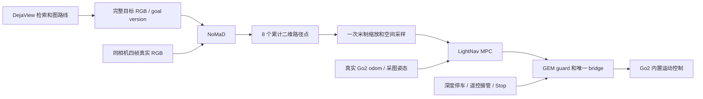

> Sanitized historical source snapshot. Dates, old hardware observations and results refer to the original deployment; paths below are portable examples, not a claim that this checkout is deployed. Current entry: [REALWORLD_GO2_CONSOLE.md](REALWORLD_GO2_CONSOLE.md).

# NoMaD / DejaView Go2 部署验收记录

> 本文件保留首轮 CPU / V4L2 与离线 shadow 的验收快照。后续已完成本机 CUDA、官方 ROS RGB-D、完整任务与执行适配；当前操作从 [部署入口](../deployment/README.md) 开始，硬件与性能实测见 [GPU / RGB-D 记录](DEJAVIEW_JETSON_GPU_RGBD_20261017.md)。下述早期缺项不代表当前状态。

2026-10-17，SSH alias `go2`，项目根目录 `/home/unitree/work/lightnav_realworld`。本次完成了模型和观测链路的实际部署；未初始化 SportClient、未运行 GEM 运动 bridge、未发送机器人运动命令。

## 当前实际完成的部分

| 检查 | 实际结果 | 结论边界 |
| --- | --- | --- |
| 源码与模型 | 最小部署包已上传，源码/权重逐文件 SHA256 校验；最小源码在全新 Python 进程中可独立加载 | 不依赖工作站上完整训练仓库的隐式导入 |
| 相机 | D435i，USB 2 / 480 M；V4L2 RGB `/dev/video4`，640×480，请求 15 Hz、按 4 Hz 选真实帧 | 图片朝天花板/横梁；未验证深度、曝光时间或前向导航 |
| 录制 RGB → GPU → MPC | 12 张真实 RGB 构成 9 个四帧窗口，全部检查通过；原 LightNav CasADi/IPOPT 求解器实际执行 9 次 | MPC 使用明确标记的合成零位姿，无 Go2 odom |
| 实时 RGB → GPU | Jetson 相机持续采样，主线程最多一个请求在途，完成 12/12 次请求，47 张采样原图保留，相机正常释放 | GPU 在工作站；此运行不调用 MPC 或任何运动接口 |
| Jetson 本机推理 | 私有 CPU venv，完整 NoMaD diffusion 推理通过，输出 8×2 有限路径，尺度/来源检查通过 | CPU 功能验收，本机 CUDA 尚未验证 |
| Jetson 本机 MPC | 读取上述模型结果，原 LightNav MPC/IPOPT 实际求解成功，参考 5×3、预测 6×3，数值有限 | 仍为合成零位姿，不使用机器人反馈 |
| ROS / Foxglove | Humble/cv_bridge 可用；用户级 Foxglove 3.6 overlay 和 9 窗录制回放已运行；7 个频道均实际收到 WebSocket 二进制消息 | GUI 导入/渲染、实时 preview relay 和 VNC 尚未验收 |

这些结果是 IO、模型数值、路径适配和求解器检查，尚未构成真机导航成功。目标图来自同次相机记录，只用于同视图诊断。

## 已测时延

| 运行方式 | 测量 | 结果 |
| --- | --- | --- |
| 工作站 RTX 5090，本地 HTTP，录制 RGB | 9 个窗口 RTT | 中位数 54.9 ms，最慢 283.6 ms，包含首次冷请求 |
| Jetson 相机 → SSH → 工作站 RTX 5090 | 12 次 RTT | 中位数 750.0 ms，最慢 1437.6 ms |
| 同一实时运行 | GPU 服务内推理 | 中位数 60.0 ms |
| 同一实时运行 | 最新源帧 dequeue 到收到结果 | 中位数 995.8 ms，最慢 1637.7 ms |
| Jetson Orin NX，15 W，CPU 单线程 | 单次首次完整 predict | 648.8 ms；初始化 3.21 s；进程峰值 RSS 456.7 MiB |
| Jetson，单线程 BLAS/OMP | 首次路径适配、MPC 构造与求解合计 | 75.47 ms；不是纯求解器稳态延迟 |

CPU 只有一次功能样本，不是稳态性能报告。4 Hz 是下一步本机推理待验目标，当前 CPU 运行尚未达到。远程 RTT 包含编码、传输、调度和服务处理，不能将差值全部归因于网络。实时客户端直接选最新四帧，不追赶积压窗口。

源时间目前明确标记为 `host_wall_clock_after_v4l2_dequeue_not_sensor_exposure`；响应年龄使用同一 Jetson 的 monotonic dequeue 代理。曝光到 dequeue 的未知延迟不在上述年龄内。这一时间契约还不能用于真实运动时的精确 odom 锚定。

## 复用成熟仓库的落点

| 来源 | 固定版本 | 本次使用 |
| --- | --- | --- |
| 官方 NoMaD | `dca79815b704e5aa9c6bdc3082351f9e3b2848c2` | 官方架构、预处理、动作恢复和诊断 PD；移除 ROS 1 transport 依赖 |
| Diffusion Policy | `5ba07ac6661db573af695b419a7947ecb704690f` | 原 ConditionalUnet1D 相关最小源码 |
| LightNav | `ddfd37059c49e8090217e11c4ffa6f6b3ff9d554` | 不改原 MPC 求解器，适配 NoMaD 路径；保留 geometry/protocol 来源 |
| GEM RealWorld | `fd23b5d4006226e7a76b2c3f0bf03a8ec16e3436` | bridge、battery、trajectory/latency guard 已 staged；Foxglove 工作流已经适配；运动模块未导入或启动 |
| TinyNav | `5705bb61dafb407594970ab2bc85c63fc71e0a24` | 独立 TigerVNC 桌面工作流已适配为可选入口，未启动 |

checkpoint 为 76,473,631 bytes，SHA256：`70f79b8262527e20e56ced64a3e3d7ef91855bc9e7c3fa348d78edcb83c6a333`。LightNav `mpc.py` SHA256：`fe97c24c6eb5ec443892ea8e6719493390a448ed036cebac1fcbd213c795c0a8`。

CPU 环境位于 `.venv-nomad-cpu`，使用官方 aarch64 CPU Torch 2.8.0/torchvision 0.23.0；版本和安装依赖单保存在 CPU 运行记录。Foxglove 通过已配置 APT 元数据校验后解包到 `.runtime/foxglove_20261017`，未运行 dpkg 安装或 maintainer scripts，未修改系统 ROS。所有新增环境和运行记录均位于用户要求的 `work` 下。

## 保留的接口设计

这是最终目标链路，图中真实反馈、执行出口及 DejaView 接口尚未接通。

- NoMaD 输出路径；`vx / wz` 由 MPC 在真实反馈下计算，Go2 `vy` 首版固定为零。无需另训练腿部策略，也不需要 VLA。
- 模型固定四张 RGB、96×96 官方 PIL resize、10 diffusion steps、8 samples 取第 0 个。当前接口保留完整选中路径，并非原 PD 单个 waypoint。其余候选尚未全部落盘。
- `get_action` 已恢复累计位置；整条路径只乘一次 `.2 / 4 = .05`，与机器人运行速度限制分开。修复了旧 wrapper 选中点原地缩放造成混合单位的风险，未改旧 baseline。
- 模型点序号没有已验证的实际时间，MPC 用 `v_ref * dt` 空间采样；yaw 来自路径切线。合成位姿结果不能被重新标为真实 odom。
- 任务携带 session/task/goal version/source frame。旧目标、旧源帧和旧求解必须失效；发布新 Twist 不能刷新旧图年龄。真实执行 guard 仍需集成和故障验证。
- 单张目标不沿用官方拓扑索引的 `reached_goal`。distance head 是时间距离估计，不能直接当作米制距离、深度或到达证据。

DejaView 后续只提供有序完整目标图以及路线游标。先跑通固定同相机目标，再人工切图、自动推进，最后接原生检索。中间节点使用图关键帧；最终目标使用命中 object sighting 对应的完整源 RGB，避免节点创建帧没有目标物体。保存源帧索引，不能把 object crop 当完整导航视图。LightNav 的模型导航保留独立 baseline；双方可使用同一已验证执行层。

## 下一步的实际顺序

1. **安装视角和传感器。** 将 D435i 固定朝前，优先直连 USB 3；保存前方地面/障碍物 RGB 与 aligned depth，验证单位、有效区域和原始时间戳。当前天花板数据不继续用于导航评价。
2. **本机 GPU。** 准备 Docker/NVIDIA runtime 后，验证候选 iGPU 镜像、CUDA 卷积、完整 NoMaD、warm latency 和源图年龄。`Dockerfile` 尚未构建；CPU wheel 的 `cuda_available=False` 只描述该 CPU 环境，不能诊断 Jetson 硬件故障。当前 `sudo -n` 不可用，不能声称系统 runtime 已装好。
3. **Go2 状态只读。** 网口保持 `enP8p1s0 / 192.168.123.18`；再次向参考地址 `192.168.123.161` 发出两个 ping 均无响应，ARP 未解析。复核实际机器人地址、网口、SDK2/CycloneDDS 和状态更新，取得真实姿态/速度；先不创建运动客户端。建立 RGB 时间到 odom 的锚定。
4. **真实反馈 MPC shadow。** 复用现有 MPC 和 geometry；补齐计划/观测/odom/深度时效与任务版本检查。验证断流、目标切换、晚到响应和旧求解不会形成可执行命令。
5. **执行层分开验收。** 先固定直线与弧线路径验证控制轴向、限速、抢占、Stop/watchdog，再接 NoMaD 单图任务。这样控制接口与策略失败可分别定位。
6. **接入 DejaView。** 固定图 → 人工关键帧序列 → 自动游标 → DejaView 检索路线，逐层保持同一局部策略与执行出口。到达评分使用独立现场记录，保留失败和人工干预。

## 记录与查看

下位机运行目录：`runs/nomad_commissioning_20261017/`。工作站镜像位于 `data/realworld/nomad_commissioning_20261017/`。

| 子目录 | 证据 |
| --- | --- |
| `rgb_capture_001/` | 12 张原 RGB、实际帧时间和设备配置 |
| `local_shadow_001/` | 9 窗模型输出、来源/尺度检查、原 MPC 合成位姿求解 |
| `live_shadow_001/` | 47 张原 RGB、12 次实时请求、源图年龄、相机正常退出状态 |
| `jetson_cpu_001/` | 本机模型输出、版本、依赖单、耗时和 strict checkpoint contract |
| `jetson_cpu_mpc_001/` | ARM64 CasADi 3.7.2、原 LightNav MPC、合成位姿求解和首次整体耗时 |
| `foxglove_001/handshake.json` | SDK 握手、只读 capabilities、7 频道实际二进制数据接收 |
| `deployment_001/` | 最终 50 文件来源/哈希清单与 `nomad_bundle_20261017_002.tar.gz` 包哈希 |

当前 Foxglove 下位机端点为 `127.0.0.1:8765`；本轮工作站隧道映射到 `ws://127.0.0.1:18765`。导入 [影子回放布局](../deployment/nomad/ops/nomad_shadow.foxglove-layout.json)。显示的是录制数据，图片和状态带明确标记，不是实时导航界面。新版 bridge 使用 `foxglove.sdk.v1`；协议检查通过，实际 GUI 渲染尚未验证。

入口、启动与依赖说明见 [NoMaD README](../deployment/nomad/README.md) 和 [操作工具 README](../deployment/nomad/ops/README.md)。本轮没有配置开机服务，也未启动 VNC 或完整旧机器人栈。
